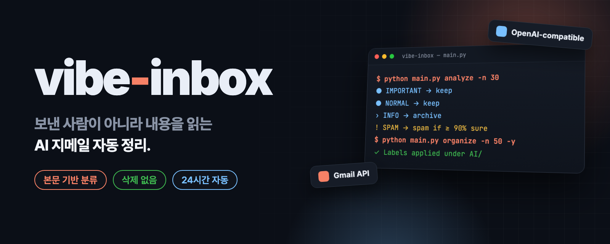
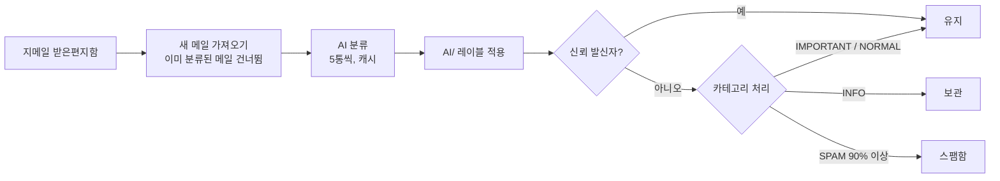

<p align="center">
  
</p>

<p align="center">
  <a href="README.md"><b>English</b></a> · <b>한국어</b>
</p>

<h2 align="center">누가 보냈는지가 아니라 무슨 내용인지로<br>스스로 정리되는 받은편지함.</h2>

<p align="center">
  vibe-inbox는 지메일을 AI가 한 통씩 읽고 4가지 레이블 중 하나를 붙인 뒤, 광고·뉴스레터는 보관 처리합니다.<br>
  아무것도 삭제하지 않으며, 스팸함 이동은 AI 확신도가 90% 이상일 때만 합니다.
</p>

<p align="center">
  <a href="LICENSE"></a>
  <a href="https://github.com/kks0488/vibe-inbox/stargazers"></a>
  
  
</p>

<table>
<tr>
<td width="50%" valign="top">

### 내용을 읽고 판단
구글 결제 영수증은 받은편지함에 남고, 구글 프로모션은 보관됩니다. 발신 도메인이 아니라 본문으로 판단합니다.

</td>
<td width="50%" valign="top">

### 기본값이 안전
삭제 기능이 아예 없습니다. 스팸 이동은 확신도 90% 이상만, 신뢰 발신자는 레이블만 붙습니다.

</td>
</tr>
<tr>
<td width="50%" valign="top">

### 먼저 미리 보기
`analyze`는 지메일을 건드리지 않고 결과만 보여 줍니다. `organize`는 작업 계획을 보여 주고 묻은 뒤 적용합니다(`-y`면 묻지 않음).

</td>
<td width="50%" valign="top">

### 알아서 계속 실행
스케줄러가 기본 30분마다 새 메일을 처리하고, 내가 보내거나 답장한 상대를 신뢰 발신자로 배웁니다. systemd나 Docker로 돌릴 수 있습니다.

</td>
</tr>
</table>

## 설치

Python 3.9 이상, Gmail API를 켠 Google Cloud 프로젝트, OpenAI 호환 API 키가 필요합니다.

```bash
git clone https://github.com/kks0488/vibe-inbox.git && cd vibe-inbox
pip install -r requirements.txt
cp env_example.txt .env     # OPENAI_API_KEY 설정 (필요하면 OPENAI_BASE_URL / OPENAI_MODEL도)
```

지메일 OAuth 클라이언트 파일을 `./credentials.json`에 둡니다(기술 세부 사항의 "Google Cloud 설정" 참고).

## 빠른 시작

```bash
python main.py auth                  # 브라우저에서 지메일 로그인
python main.py status                # 로그인·API 키·받은편지함 수 확인
python main.py analyze -n 30         # 미리 보기: 분류만, 변경 없음
python main.py organize -n 50        # 계획 표시 → 확인 → 레이블/보관 적용
python main.py                       # 대화형 메뉴
```

## 데모

이메일 30통에 `organize`를 실행한 모습입니다. 출력 형식은 코드 그대로이고, 개수는 실제 메일함이 아닌 예시 값입니다. 마지막 테스트 실행은 실제 결과입니다.

<p align="center"></p>

## 동작 방식

| 카테고리 | 대상 | 예시 | 처리 |
|----------|------|------|------|
| **IMPORTANT (중요)** | 나에게 직접 해당, 확인 필요 | 결제 완료, 비밀번호 재설정, 배송, 내 글의 답글 | 유지 |
| **NORMAL (일반)** | 일상적인 서비스 알림 | GitHub PR, Slack 알림, 월간 리포트 | 유지 |
| **INFO (정보)** | 대량 마케팅·뉴스레터 | 할인 광고, "이 사람을 팔로우하세요", 트렌드 리포트 | **보관** |
| **SPAM (스팸)** | 피싱·사기·콜드 영업 | 출처 불명 광고, 복권 당첨 | 스팸함(확신도 90% 이상) |

처리한 메일에는 모두 `AI/` 아래 레이블이 붙습니다. 5통씩 묶어 분류하고, 결과를 24시간 캐시해 같은 메일을 AI에 두 번 보내지 않습니다.



스케줄러는 이 밖에도 처음 연락한 발신자의 콜드 메일 확인(레이블만), 하루 한 번 신뢰 발신자 학습, 스팸 처리 내역 주간 메일 보고, 토큰 만료 전 갱신, 오류 시 슬랙 알림(선택)을 합니다.

## 자주 묻는 질문

**메일을 삭제하나요?**
아니요. 레이블, 보관(받은편지함에서 빼기), 스팸함 이동만 합니다. 보관한 메일은 "전체보관함"에 그대로 있습니다.

**어떤 AI 모델을 쓰나요?**
OpenAI 호환 엔드포인트면 됩니다. `OPENAI_BASE_URL`과 `OPENAI_MODEL`로 정하며, 기본 모델은 `gpt-5.2`, 실패 시 `gpt-5.1`, `gpt-5` 순으로 바꿉니다.

**AI에 무엇이 전달되나요?**
제목, 보낸 사람, 본문 앞부분입니다. 묶음 분류는 메일당 300자, 한 통씩 분류할 때는 최대 1,800자입니다.

**특정 발신자를 보호할 수 있나요?**
네. `safe_senders.example.json`을 `safe_senders.json`으로 복사해 발신자나 도메인을 적으면, 레이블만 붙고 보관·스팸 처리되지 않습니다.

## 로드맵 (계획, 아직 구현 안 됨)

- CLI 영어 출력 옵션(현재 한국어).
- `config.py` 대신 설정 파일로 카테고리 규칙 수정.

---

<details>
<summary><b>기술 세부 사항</b></summary>

### Google Cloud 설정 (Gmail API)

1. [Google Cloud Console](https://console.cloud.google.com/)에서 프로젝트를 만들거나 고릅니다.
2. API 및 서비스 → 라이브러리 → **Gmail API** 사용 설정.
3. OAuth 동의 화면 → 외부 → 아래 범위를 추가하고 내 계정을 테스트 사용자로 추가:
   - `https://www.googleapis.com/auth/gmail.readonly`
   - `https://www.googleapis.com/auth/gmail.modify`
   - `https://www.googleapis.com/auth/gmail.labels`
4. 사용자 인증 정보 → OAuth 클라이언트 ID → **데스크톱 앱** → JSON 다운로드.
5. 프로젝트 폴더에 `credentials.json`으로 저장.

### 환경 변수 (`.env`)

```bash
OPENAI_API_KEY=your_api_key_here
OPENAI_BASE_URL=https://api.openai.com/v1   # OpenAI 호환 엔드포인트
OPENAI_MODEL=gpt-5.2
GMAIL_CREDENTIALS_PATH=credentials.json

# 선택
SLACK_ENABLED=false
SLACK_BOT_TOKEN=your-slack-bot-token
SLACK_GMAIL_CHANNEL_ID=C1234567890
AUTO_LEARN_SAFE_SENDERS=true
SKIP_ALREADY_CLASSIFIED=true
LOG_LEVEL=INFO
```

`OPENAI_BASE_URL`을 비워 두면 코드 기본값은 로컬 OpenAI 호환 프록시(`http://localhost:8317/v1`)입니다.

### CLI

```bash
python main.py status                 # 로그인·API 키·받은편지함 통계
python main.py auth                   # 지메일 OAuth
python main.py analyze -n 50          # 분류만
python main.py analyze -q "is:unread" # 지메일 검색어 지정
python main.py organize -n 30         # 분류 + 적용(먼저 확인)
python main.py organize -n 50 -y      # 확인 없이 적용
python main.py logout                 # 저장된 토큰 삭제
```

### `config.py` 설정

```python
OPENAI_MODEL = os.getenv("OPENAI_MODEL", "gpt-5.2")
SPAM_CONFIDENCE_THRESHOLD = 0.9
LABEL_PREFIX = "AI/"
DEFAULT_BATCH_SIZE = 50
CLASSIFICATION_CACHE_TTL_HOURS = 24

EMAIL_CATEGORIES = {
    "SPAM": {"action": "spam"},   # "spam", "archive", "keep"
    ...
}
```

### 스케줄러

```bash
python scheduler.py                               # 30분마다 정리
python scheduler.py --interval 60 --batch-size 100
python scheduler.py --analyze-only                # 분류와 기록만, 변경 없음
```

### 우분투 서버 (systemd)

```bash
scp -r vibe-inbox username@your-server:~/
ssh username@your-server
cd ~/vibe-inbox && chmod +x install_ubuntu.sh && ./install_ubuntu.sh   # ~/gmail-organizer에 설치
```

OAuth 로그인에는 브라우저가 필요합니다. 내 PC에서 로그인한 뒤 `token.json`, `credentials.json`, `.env`를 `~/gmail-organizer/`로 복사하거나, 포트 포워딩을 씁니다.

```bash
ssh -L 8080:localhost:8080 username@your-server
cd ~/gmail-organizer && source venv/bin/activate && python main.py auth
```

그다음:

```bash
sudo systemctl enable --now gmail-organizer
sudo systemctl status gmail-organizer
tail -f ~/gmail-organizer/logs/scheduler.log
```

`gmail-organizer.logrotate`로 로그 파일을 순환합니다.

### Docker

```bash
docker-compose up -d       # scheduler.py -i 30 실행, token.json·credentials.json·safe_senders.json·logs/ 연결
docker-compose logs -f
```

### 파일 구조

```
main.py                 CLI와 대화형 메뉴
scheduler.py            상시 실행 데몬
auth.py                 지메일 OAuth와 토큰 갱신
gmail_client.py         Gmail API(배치 요청, 레이블, 보관, 스팸)
ai_classifier.py        분류 프롬프트, 묶음 처리, 캐시, 모델 폴백
cold_email_blocker.py   처음 연락한 발신자의 콜드 메일 확인
safe_sender_learner.py  보낸 메일·답장에서 신뢰 발신자 학습
email_reporter.py       주간 스팸 보고 메일
slack_notifier.py       슬랙 알림(선택)
classification_stats.py 분류 기록
config.py               전체 설정
tests/                  pytest 테스트
```

### 테스트

```bash
pip install -r requirements.txt
pytest -q
```

### 문제 해결

- **"credentials.json 파일이 필요합니다":** 데스크톱 OAuth 클라이언트를 만들고 JSON을 `credentials.json`으로 저장.
- **"OpenAI API 키가 필요합니다":** `.env`에 `OPENAI_API_KEY` 설정.
- **토큰 만료:** `python main.py auth`를 다시 실행하거나 `token.json`을 지우고 다시 로그인.
- **API 한도:** 잠시 후 다시 시도하거나 `config.py`의 `DEFAULT_BATCH_SIZE`를 줄임.

자세한 구조는 [docs/architecture.md](docs/architecture.md).

</details>

## 라이선스

[MIT](LICENSE)
