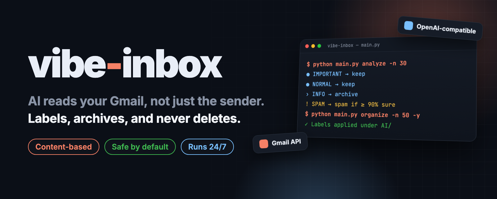
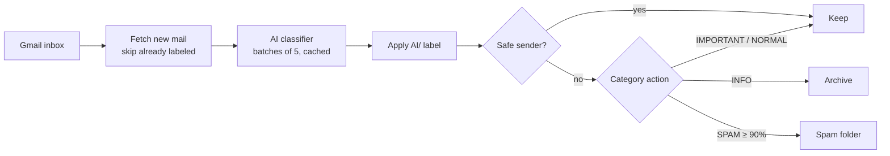

<p align="center">
  
</p>

<p align="center">
  <b>English</b> · <a href="README.ko.md"><b>한국어</b></a>
</p>

<h2 align="center">An inbox that sorts itself by what the email says,<br>not by who sent it.</h2>

<p align="center">
  vibe-inbox reads each Gmail message with an AI model, puts it in one of four labels, and archives the marketing.<br>
  It never deletes anything, and it only moves mail to spam when the model is at least 90% sure.
</p>

<p align="center">
  <a href="LICENSE"></a>
  <a href="https://github.com/kks0488/vibe-inbox/stargazers"></a>
  
  
</p>

<table>
<tr>
<td width="50%" valign="top">

### Reads the content
A payment receipt from Google stays in your inbox; a Google promo gets archived. The model judges the body text, not the sender's domain.

</td>
<td width="50%" valign="top">

### Safe by default
There is no delete action. Spam moves need ≥ 90% confidence, and senders on your safe list only ever get a label.

</td>
</tr>
<tr>
<td width="50%" valign="top">

### Dry run first
`analyze` shows what it would do without touching Gmail. `organize` shows a plan and asks before applying it (`-y` skips the prompt).

</td>
<td width="50%" valign="top">

### Runs on its own
A scheduler processes new mail every 30 minutes by default, learns safe senders from mail you sent or replied to, and runs under systemd or Docker.

</td>
</tr>
</table>

## Install

Requires Python 3.9+, a Google Cloud project with the Gmail API enabled, and an OpenAI-compatible API key.

```bash
git clone https://github.com/kks0488/vibe-inbox.git && cd vibe-inbox
pip install -r requirements.txt
cp env_example.txt .env     # set OPENAI_API_KEY (and OPENAI_BASE_URL / OPENAI_MODEL if needed)
```

Put your Gmail OAuth client file at `./credentials.json` (see "Google Cloud setup" under Technical details).

## Quick start

```bash
python main.py auth                  # sign in to Gmail in the browser
python main.py status                # check sign-in, API key and inbox counts
python main.py analyze -n 30         # dry run: classify only, change nothing
python main.py organize -n 50        # show the plan, ask, then label/archive
python main.py                       # interactive menu
```

## Demo

`organize` on 30 emails. The output format is taken from the code (the CLI prints in Korean); the counts are sample values, not a real mailbox. The test run at the end is real.

<p align="center"></p>

## How it works

| Category | Meant for | Examples | Action |
|----------|-----------|----------|--------|
| **IMPORTANT** | Personal, needs attention | Payment done, password reset, shipping, replies to your posts | Keep |
| **NORMAL** | Routine service mail | GitHub PRs, Slack alerts, monthly reports | Keep |
| **INFO** | Bulk marketing and newsletters | Discount promos, "follow this person", trend reports | **Archive** |
| **SPAM** | Phishing, scams, cold sales | Unknown ads, lottery wins | Spam folder (≥ 90% confidence) |

Every processed email gets a label under `AI/`. Emails are classified in batches of 5, and results are cached for 24 hours so the same email is not sent to the model twice.



The scheduler also runs a first-contact cold-email check (label only), daily safe-sender learning, a weekly email report of what went to spam, token refresh before expiry, and optional Slack alerts for errors.

## FAQ

**Does it ever delete email?**
No. The only actions are label, archive (remove from inbox) and move to spam. Archived mail is still in "All Mail".

**Which AI model does it use?**
Any OpenAI-compatible endpoint. Set `OPENAI_BASE_URL` and `OPENAI_MODEL`; the default model is `gpt-5.2`, with `gpt-5.1` and `gpt-5` as fallbacks.

**What does the model see?**
Subject, sender and the start of the body: 300 characters per email in batch mode, up to 1,800 when an email is classified on its own.

**Can I protect certain senders?**
Yes. Copy `safe_senders.example.json` to `safe_senders.json` and list senders or domains. They are labeled but never archived or moved to spam.

## Roadmap (planned, not built yet)

- English output option for the CLI (currently Korean).
- Category rules editable from a config file instead of `config.py`.

---

<details>
<summary><b>Technical details</b></summary>

### Google Cloud setup (Gmail API)

1. In [Google Cloud Console](https://console.cloud.google.com/), create or select a project.
2. APIs & Services → Library → enable **Gmail API**.
3. OAuth consent screen → External → add these scopes and add your account as a test user:
   - `https://www.googleapis.com/auth/gmail.readonly`
   - `https://www.googleapis.com/auth/gmail.modify`
   - `https://www.googleapis.com/auth/gmail.labels`
4. Credentials → Create credentials → OAuth client ID → **Desktop app** → Download JSON.
5. Save it as `credentials.json` in the project folder.

### Environment variables (`.env`)

```bash
OPENAI_API_KEY=your_api_key_here
OPENAI_BASE_URL=https://api.openai.com/v1   # any OpenAI-compatible endpoint
OPENAI_MODEL=gpt-5.2
GMAIL_CREDENTIALS_PATH=credentials.json

# Optional
SLACK_ENABLED=false
SLACK_BOT_TOKEN=your-slack-bot-token
SLACK_GMAIL_CHANNEL_ID=C1234567890
AUTO_LEARN_SAFE_SENDERS=true
SKIP_ALREADY_CLASSIFIED=true
LOG_LEVEL=INFO
```

If `OPENAI_BASE_URL` is not set, the code defaults to a local OpenAI-compatible proxy (`http://localhost:8317/v1`).

### CLI

```bash
python main.py status                 # sign-in, API key, inbox stats
python main.py auth                   # Gmail OAuth
python main.py analyze -n 50          # classify only
python main.py analyze -q "is:unread" # with a Gmail search query
python main.py organize -n 30         # classify + apply (asks first)
python main.py organize -n 50 -y      # apply without asking
python main.py logout                 # remove the saved token
```

### Settings in `config.py`

```python
OPENAI_MODEL = os.getenv("OPENAI_MODEL", "gpt-5.2")
SPAM_CONFIDENCE_THRESHOLD = 0.9
LABEL_PREFIX = "AI/"
DEFAULT_BATCH_SIZE = 50
CLASSIFICATION_CACHE_TTL_HOURS = 24

EMAIL_CATEGORIES = {
    "SPAM": {"action": "spam"},   # "spam", "archive" or "keep"
    ...
}
```

### Scheduler

```bash
python scheduler.py                               # every 30 min, organize
python scheduler.py --interval 60 --batch-size 100
python scheduler.py --analyze-only                # classify and log only, no changes
```

### Ubuntu server (systemd)

```bash
scp -r vibe-inbox username@your-server:~/
ssh username@your-server
cd ~/vibe-inbox && chmod +x install_ubuntu.sh && ./install_ubuntu.sh   # installs to ~/gmail-organizer
```

OAuth needs a browser. Either sign in locally and copy `token.json`, `credentials.json` and `.env` to `~/gmail-organizer/`, or use port forwarding:

```bash
ssh -L 8080:localhost:8080 username@your-server
cd ~/gmail-organizer && source venv/bin/activate && python main.py auth
```

Then:

```bash
sudo systemctl enable --now gmail-organizer
sudo systemctl status gmail-organizer
tail -f ~/gmail-organizer/logs/scheduler.log
```

`gmail-organizer.logrotate` rotates the log files.

### Docker

```bash
docker-compose up -d       # runs scheduler.py -i 30; mounts token.json, credentials.json, safe_senders.json, logs/
docker-compose logs -f
```

### Project structure

```
main.py                 CLI and interactive menu
scheduler.py            Long-running daemon
auth.py                 Gmail OAuth and token refresh
gmail_client.py         Gmail API (batch requests, labels, archive, spam)
ai_classifier.py        Classification prompt, batching, cache, model fallback
cold_email_blocker.py   First-contact cold email check
safe_sender_learner.py  Learns safe senders from sent mail and replies
email_reporter.py       Weekly spam report email
slack_notifier.py       Optional Slack alerts
classification_stats.py Classification history
config.py               All settings
tests/                  pytest suite
```

### Tests

```bash
pip install -r requirements.txt
pytest -q
```

### Troubleshooting

- **"credentials.json file not found":** create a Desktop OAuth client and save the JSON as `credentials.json`.
- **"OpenAI API key required":** set `OPENAI_API_KEY` in `.env`.
- **Token expired:** run `python main.py auth` again, or delete `token.json` and sign in.
- **Rate limits:** wait and retry, or lower `DEFAULT_BATCH_SIZE` in `config.py`.

More in [docs/architecture.md](docs/architecture.md).

</details>

## License

[MIT](LICENSE)
