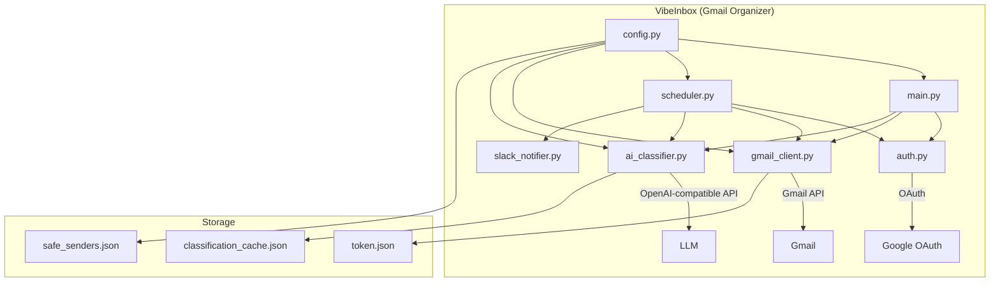

# VibeInbox Architecture

## System Overview

## Data Flow

1. **Authentication**: `auth.py` handles OAuth 2.0 flow with Google
2. **Email Fetching**: `gmail_client.py` retrieves emails via Gmail API
3. **Classification**: `ai_classifier.py` sends emails to an OpenAI-compatible model for classification
4. **Action**: Based on classification, emails are labeled/archived/moved
5. **Notification**: Optional Slack notifications via `slack_notifier.py`

## Module Responsibilities

| Module | Responsibility |
|--------|---------------|
| `main.py` | CLI interface, user interaction |
| `scheduler.py` | Background scheduling, orchestration |
| `gmail_client.py` | Gmail API wrapper |
| `ai_classifier.py` | AI classification (OpenAI-compatible API) |
| `auth.py` | OAuth authentication |
| `config.py` | Configuration management |
| `utils.py` | Shared utilities |
| `exceptions.py` | Custom exception classes |
| `slack_notifier.py` | Slack integration |

## Classification Categories

| Category | Description | Action |
|----------|-------------|--------|
| IMPORTANT | Directly relevant emails | Keep in inbox |
| NORMAL | General notifications | Keep in inbox |
| INFO | Marketing/newsletters | Archive |
| SPAM | Malicious/scam emails | Move to spam |
